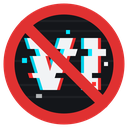
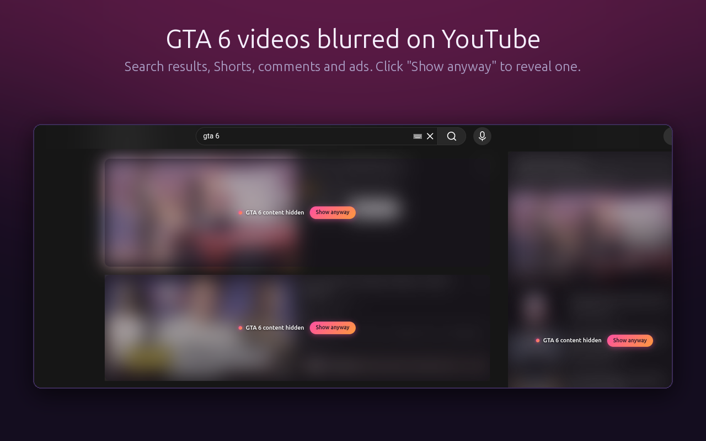

<p align="center">
  
</p>

<h1 align="center">Content Blocker for GTA 6</h1>

<p align="center">
  A browser extension that blurs or hides GTA 6 content and spoilers on YouTube, X and Reddit.<br>
  For everyone waiting for the PC version, or anyone who wants to go in blind.
</p>

<p align="center">
  
</p>

## Install

- **Chrome, Edge, Brave, Opera:** [Chrome Web Store](https://chromewebstore.google.com/detail/content-blocker-for-gta-6/agncdppnkhgpccobpilhgpdagijacjpb)
- **Firefox:** Firefox Add-ons (in review, coming soon)

## Features

- Blurs GTA 6 videos, Shorts, thumbnails, posts, tweets, comments, search results and ads.
- Works while you scroll and when you move between pages.
- **Strict** mode hides everything about the game. **Spoilers only** lets news through and hides endings, missions, leaks and story stuff.
- Blur or hide completely.
- "Show anyway" reveals a single post.
- Turn it off on one site and keep it on the others.
- Add your own words to block, or words that should never be blocked.

## Supported sites

| Site | What gets blocked |
|---|---|
| YouTube | Home feed, search, related videos, Shorts, comments, ads |
| X (Twitter) | Tweets, quoted tweets, trends |
| Reddit | Posts, comments, search results (new and old Reddit) |

## Privacy

No data collection, no analytics, no ads, no network requests. Everything runs locally in your browser.
The only permissions are `storage` (your settings) and access to the sites above. See [PRIVACY.md](PRIVACY.md).

## How it works

The content script checks the text of each video, post or comment as it appears on the page.
A post is blocked when it mentions GTA 6 directly (`gta 6`, `gta vi`, `vice city`, `leonida`, character names...),
or when it mentions two different ambiguous names together, so a random video about "Jason" stays visible.
In Spoilers only mode it also needs a spoiler word like `ending`, `leak` or `final mission`.

Site selectors live in [`src/content/sites.ts`](src/content/sites.ts) and keywords in [`src/shared/defaults.ts`](src/shared/defaults.ts).

## Development

Requires Node 24.

```bash
npm install
npm run watch       # build to dist/ and rebuild on changes
npm test            # matcher tests
npm run typecheck
npm run zip         # production zip for the stores
```

Load the extension from `dist/`:

- Chrome: `chrome://extensions` → Developer mode → Load unpacked
- Firefox: `about:debugging` → This Firefox → Load Temporary Add-on → `dist/manifest.json`

## Contributing

Sites change their HTML often, so selectors break. If something stops getting blurred, open an issue with the page URL
or send a PR that updates `sites.ts`. New keywords (missions, characters, places) are welcome too.

## Support

The extension is free. If it saved your playthrough, you can [buy me a coffee](https://buymeacoffee.com/leszkusz6).

## License

[MIT](LICENSE)

Not affiliated with Rockstar Games or Take-Two Interactive. GTA and Grand Theft Auto are trademarks of Take-Two Interactive.
